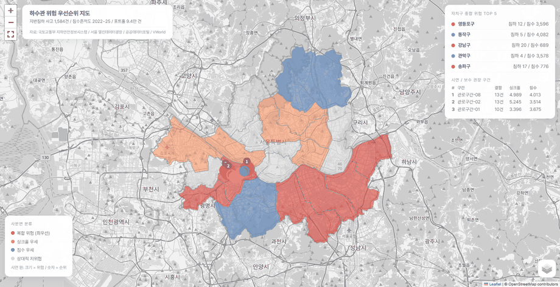
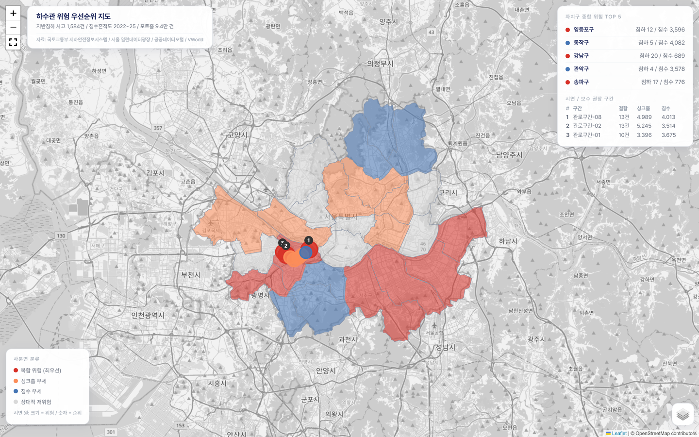
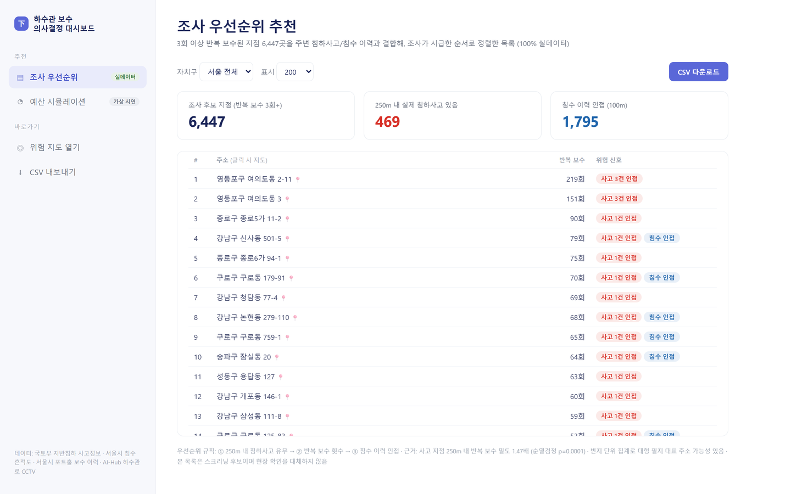
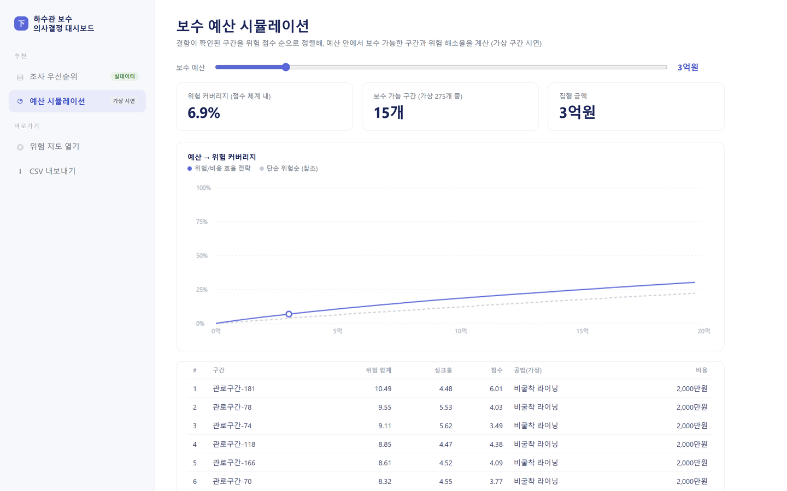
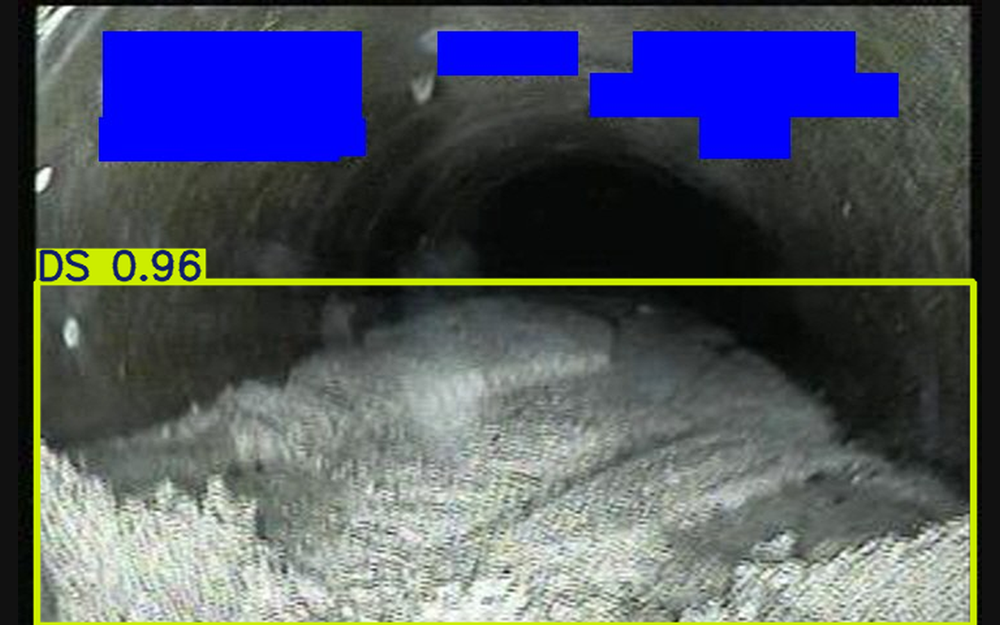
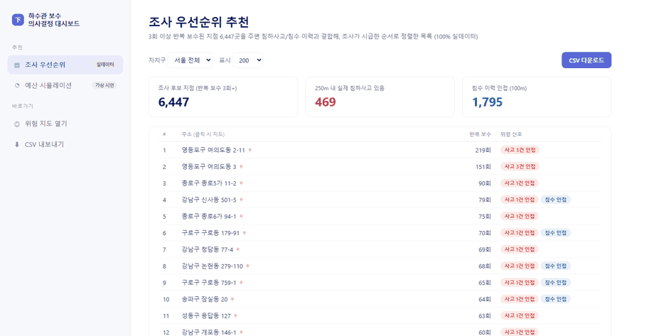
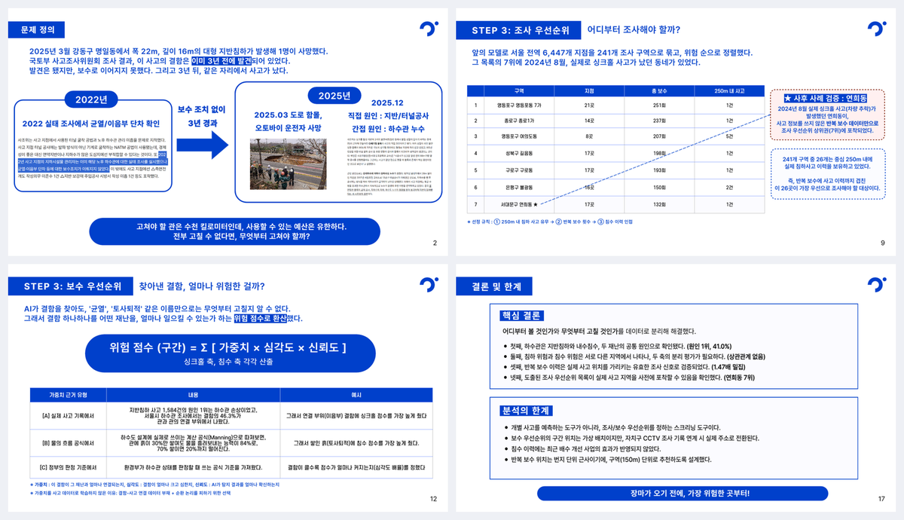
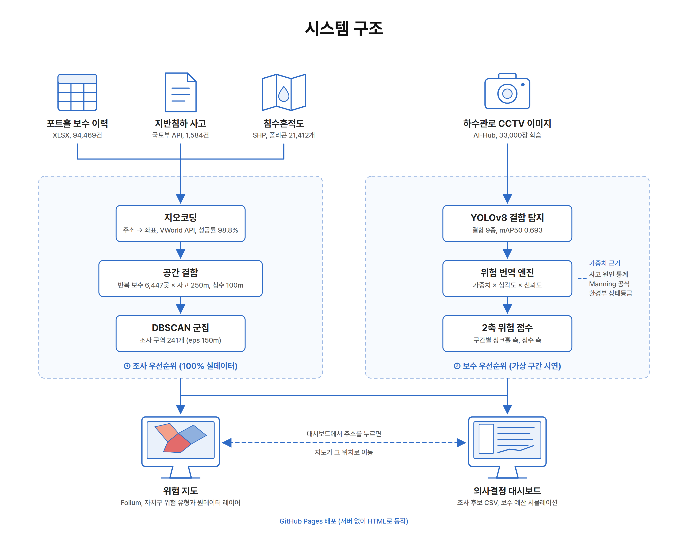
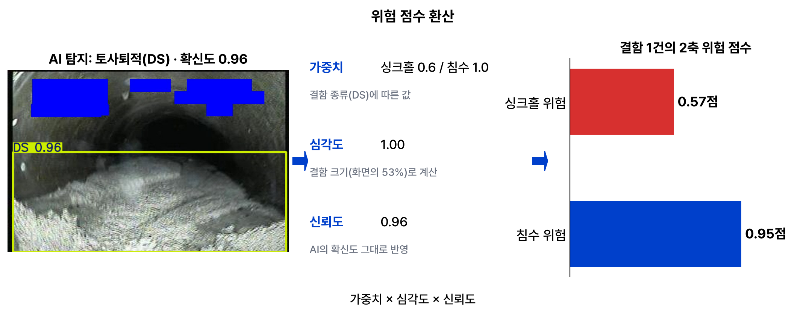
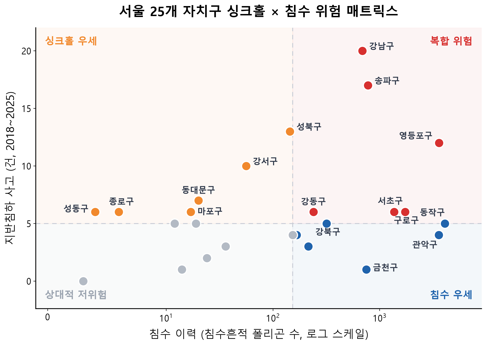

<div align="center">

# 장마가 오기 전에

**하수관 결함을 싱크홀 위험과 침수 위험으로 환산해, 자치구별로 어디부터 조사하고 무엇부터 보수할지 정하는 분석 시스템**

🏆 26-1 명지대학교 창의적 SW 경진대회 빅데이터 분석 부문 **최우수상**

[🔗 데모 바로가기](https://yejineeeee.github.io/sewer-risk-priority/) | [📄 발표자료 (PDF)](https://yejineeeee.github.io/sewer-risk-priority/%EB%B0%9C%ED%91%9C%20PPT_%ED%86%B0%EA%B3%BC%EC%A0%A4%EB%A6%AC.pdf) | [🧮 위험 번역 엔진](scripts/risk_engine.py)



&nbsp;&nbsp;&nbsp;&nbsp;&nbsp;&nbsp;

</div>

<br>

## 📌 프로젝트 개요

| 항목 | 내용 |
|---|---|
| 기간 | 2026.07.17 ~ 2026.08.14 |
| 인원 | 개인 (TEAM 톰과젤리) |
| 수상 | 26-1 명지대학교 창의적 SW 경진대회 빅데이터 분석 부문 최우수상 |
| 배포 | GitHub Pages (위험 지도, 의사결정 대시보드) |

2025년 3월 강동구 명일동에서 대형 지반침하로 인명 피해가 발생했다.
사고조사위원회 조사 결과, 이 지점의 하수관 결함은 3년 전 실태 조사에서 이미 발견되어 있었으나 보수로 이어지지 않았다.

이처럼 서울에서 정비가 필요한 하수관은 수천 km인데, 사용할 수 있는 예산은 한정되어 있다.
CCTV 조사로 결함을 찾고 환경부 기준으로 상태 등급을 매기는 체계는 이미 있지만, 발견된 결함 중 무엇부터 조치할지 정하는 기준은 없다.
따라서 이 프로젝트는 그 공백을 데이터로 메우고자 했다.

<br>

## ✨ 주요 기능

문제를 세 단계로 나눴다.

| 단계 | 질문 | 방법 | 데이터 |
|---|---|---|---|
| 1 | 어디부터 조사할 것인가 | 반복 보수 이력에 사고, 침수를 공간 결합하고 구역으로 군집화 | 100% 실데이터 |
| 2 | 무슨 결함이 있는가 | CCTV 영상에서 결함 자동 탐지 (YOLOv8) | AI-Hub 33,000장 학습 |
| 3 | 무엇부터 고칠 것인가 | 결함을 싱크홀, 침수 2축 위험 점수로 환산 | 가상 구간 시연 |

### 화면 구성

| 위험 지도 | 조사 우선순위 |
|:---:|:---:|
|  |  |
| 자치구별 위험 유형 위에 침수 실측 21,412곳, 반복 보수 6,447지점, 실제 사고 152지점을 겹친다 | 자치구를 고르면 조사 후보 주소가 위험 신호와 함께 정렬되고 CSV로 내려받을 수 있다 |
| **보수 예산 시뮬레이션** | **결함 탐지** |
|  |  |
| 예산을 조절하면 보수 가능한 구간 수와 위험 해소율이 바로 계산된다 | 학습한 YOLOv8 모델이 CCTV 이미지에서 결함을 찾는다 |

<details>
<summary><b>대시보드 시연 보기</b></summary>



대시보드에서 주소를 누르면 위험 지도가 해당 위치로 이동한다.

</details>

### 발표자료

[](https://yejineeeee.github.io/sewer-risk-priority/%EB%B0%9C%ED%91%9C%20PPT_%ED%86%B0%EA%B3%BC%EC%A0%A4%EB%A6%AC.pdf)

[전체 보기 (PDF, 19장)](https://yejineeeee.github.io/sewer-risk-priority/%EB%B0%9C%ED%91%9C%20PPT_%ED%86%B0%EA%B3%BC%EC%A0%A4%EB%A6%AC.pdf)

<br>

## 🏗 시스템 구조

<p align="center"></p>

### 기술 스택

| 구분 | 사용 기술 |
|---|---|
| 데이터 처리 | Python, pandas, pyshp, shapely, pyproj |
| 분석 | scikit-learn (DBSCAN), 순열검정, 스피어만 상관 |
| 결함 탐지 | Ultralytics YOLOv8s, Google Colab A100 |
| 지오코딩 | VWorld Geocoder API |
| 시각화 | Folium, HTML, JavaScript |
| 배포 | GitHub Pages |

<br>

## 📊 분석 결과

### 조사 우선순위

3회 이상 반복 보수된 지점 6,447곳 각각에 반경 250m의 침하사고(EPDO 가중)와 100m의 침수 이력을 결합했다.
조사는 지점이 아니라 구간 단위로 이뤄지므로 DBSCAN(eps 150m, 최소 5지점)으로 묶어 조사 구역 241개를 도출했고, 이 중 26곳은 반경 안에 실제 사고 이력이 있다.

2024년 8월 싱크홀 사고가 발생했던 서대문구 연희동이, 사고 정보를 쓰지 않고 보수 이력만으로 만든 목록의 7위에 포함됐다.

### 결함 탐지

YOLOv8을 33,000장으로 학습하고 학습에 쓰지 않은 테스트 3,300장으로 평가해 전체 mAP50 0.693을 얻었다.
위험 가중치가 큰 토사퇴적(0.941)과 이음부 단차(0.794)에서 성능이 가장 높다.
균열 계열은 0.5 안팎에 그치는데, 점수를 사진 단위가 아닌 구간 합산으로 매기고 confidence를 곱해 반영하는 구조로 완충했다.

### 위험 번역

```
위험 점수(구간) = Σ [ 가중치 × 심각도 × 신뢰도 ]   (싱크홀 축, 침수 축 각각)
```

가중치는 학습하지 않고 설계했다. 대신 세 가지 독립 근거를 썼다.

- **사고 통계**: 사고 1,584건 원인 분석과 서울시 조사의 접합부 결함 46.3%를 근거로 이음부 계열에 싱크홀 최고 가중
- **수리 계산**: Manning 공식상 퇴적 30%에서 통수능 84%, 70%에서 20%로 떨어지므로 토사퇴적에 침수 최고 가중
- **판정 기준**: 환경부 하수관로 상태등급으로 결함 크기별 심각도 배율 결정

각 가중치와 그 근거는 [`scripts/risk_engine.py`](scripts/risk_engine.py) 주석에 모두 적어뒀다.



### 설계 근거: 두 위험을 합치지 않은 이유

지반침하 사고 1,584건을 직접 집계한 결과 원인 1위는 하수관 손상(41.0%)이고, 사고의 48.3%가 6~8월에 집중됐다.
구별 침하사고와 침수 이력의 상관은 ρ=0.151, 순열검정 p=0.47로 유의하지 않았다.
침하가 잦은 구와 침수가 잦은 구가 다르다는 뜻이라, 두 위험을 하나로 합치지 않고 축을 분리했다.



<br>

## ✅ 검증

| 방법 | 결과 |
|---|---|
| 사례-대조 공간 검증 | 사고 지점 250m 안의 반복 보수 밀도가 무작위 대조점의 1.47배 (순열검정 p=0.0001). 사고의 82%가 인접. 반경 500m에서는 차이 소멸 (1.07배, p=0.21) |
| 가중치 민감도 | ±30% 무작위 교란 200회에도 상위 10개 순위 83.8% 유지 (±10% 92.4%, ±20% 87.3%) |
| 독립 신호 교차 | 가중치 설계에 쓰지 않은 포트홀 신고량과 침하사고의 상관 ρ=0.412 (p=0.041) |
| 탐지 오류 교란 | confidence ±20%에 83.8% 유지, 결함 20% 미탐 시 55.8%로 하락 |

<br>

## 🔥 트러블슈팅

<details>
<summary><b>1. 사고 데이터에 좌표가 비어 있던 문제</b></summary>

- **문제**: 국토부 지반침하 API의 상세 조회에는 위도, 경도 필드가 있었지만 실제로 값이 채워진 사고는 하나도 없었다. 주소만 100% 들어 있어서, 이대로는 사고 지점을 지도에 찍거나 반경을 계산할 수 없었다.
- **해결**: VWorld 지오코더로 주소를 좌표로 바꿨다. 수천 건을 한 번에 돌리다 끊기는 경우를 대비해 중간 저장과 이어하기, 네트워크가 끊기면 자동으로 멈추는 기능을 넣었다.
- **결과**: 서울 사고 157건 중 152건, 반복 보수 지점 6,447곳을 좌표로 바꿨다. 지오코딩 성공률은 98.8%였다.

</details>

<details>
<summary><b>2. 데이터마다 좌표계와 인코딩이 달랐던 문제</b></summary>

- **문제**: 침수흔적도는 EPSG:5179 미터 좌표로 된 SHP 파일이었고, 나머지 데이터는 주소 텍스트였다. 게다가 SHP의 속성 파일(DBF)과 압축 파일 이름이 cp949로 되어 있어서, 기본 설정으로 읽으면 한글이 모두 깨졌다.
- **해결**: pyproj로 침수흔적도를 WGS84 좌표로 변환하고, SHP를 읽을 때 인코딩을 cp949로 지정했다. 주소 데이터는 1번처럼 지오코딩해서 같은 좌표계로 맞췄다.
- **결과**: 사고, 침수, 포트홀 보수, 행정경계 데이터를 하나의 지도 위에 겹치고 반경 단위로 결합할 수 있게 되었다.

</details>

<details>
<summary><b>3. AI-Hub 이미지를 Colab에서 받을 수 없던 문제</b></summary>

- **문제**: AI-Hub가 해외 IP를 차단해서 Colab에서는 데이터를 직접 받을 수 없었다. 로컬에서 받으려 해도 디스크 여유 공간이 13.8GB라 47만 장 전체는 받을 수 없었다.
- **해결**: 로컬에서 AI-Hub API로 결함 9종 위주의 33,000장만 골라 받고, COCO 라벨을 YOLO 형식으로 바꿔 train 26,400장, val 3,300장, test 3,300장으로 나눴다. 이 묶음을 Google Drive에 올려 Colab A100에서 학습했다.
- **결과**: 2.2시간, 42 epoch에서 조기 종료되었고 테스트 mAP50 0.693을 얻었다. 재현용 스크립트는 `scripts/build_subset.py`, `scripts/coco_to_yolo.py`에 있다.

</details>

<details>
<summary><b>4. 가중치를 학습하면 순환 논리가 되던 문제</b></summary>

- **문제**: 결함마다 위험 가중치를 정해야 했는데, 결함과 사고가 연결된 공개 데이터가 없었다. 사고가 잦은 곳의 결함에 높은 가중치를 주면, 사고 다발지를 다시 위험하다고 판정하는 순환 논리가 된다.
- **해결**: 가중치를 학습하지 않고 사고 원인 통계, Manning 공식, 환경부 상태등급의 세 가지 독립 근거로 설계했다. 각 가중치의 근거는 코드 주석에 모두 남겼다.
- **결과**: 가중치를 ±30% 범위에서 무작위로 200번 흔들어도 상위 10개 순위가 83.8% 유지되었다. 정확한 값보다 순서가 근거에 의해 정해진다는 것을 보였다.

</details>

<details>
<summary><b>5. 결함을 놓치면 순위가 크게 흔들리던 문제</b></summary>

- **문제**: 탐지 오류가 순위에 주는 영향을 따로 실험해 보니, confidence 값이 ±20% 흔들리는 것은 상위 10개 순위의 83.8%를 유지했다. 하지만 결함을 20% 놓치는 경우에는 유지율이 55.8%로 떨어졌다.
- **해결**: 잘못 찾는 것보다 놓치는 것이 순위에 훨씬 큰 영향을 준다는 결과를 바탕으로, 탐지 문턱값을 낮춰 결함을 놓치지 않는 쪽(recall 우선)으로 운영하도록 규칙을 정했다.
- **결과**: 탐지 모델의 성능 지표를 실제 운영 기준으로 연결할 수 있었다. 잘못 찾은 결함은 조사 단계에서 사람이 걸러낼 수 있기 때문이다.

</details>

<br>

## 🗂 데이터

| 데이터 | 형식 | 규모 | 출처 |
|---|---|---|---|
| 지반침하 사고정보 | API (JSON) | 1,584건 (2018~25) | 국토교통부 지하안전정보시스템 |
| 침수흔적도 | SHP (EPSG:5179) | 폴리곤 21,412개 (2022~25) | 서울시 공간정보 |
| 포트홀 보수 이력 | XLSX | 94,469건 (2023~25) | 서울 열린데이터광장 |
| 하수관로 CCTV 결함 이미지 | JPG + COCO | 47만 장 중 33,000장 | AI-Hub |
| 행정경계 | GeoJSON | 자치구 25개 | 서울시 |

AI-Hub 이미지는 이용약관상 제3자 재배포가 금지되어 이 저장소에 넣지 않았다.

<br>

## 📂 폴더 구조

```
sewer-risk-priority
├── scripts/
│   ├── risk_engine.py          # 위험 번역 엔진 (가중치와 근거 주석)
│   ├── build_survey_list.py    # 조사 우선순위 산출
│   ├── demo_e2e.py             # 탐지 → 위험 점수 파이프라인
│   ├── geocode_batch.py        # 주소 지오코딩 (VWorld)
│   ├── build_map.py            # 위험 지도 생성
│   ├── build_dashboard.py      # 의사결정 대시보드 생성
│   ├── build_*.py              # 분석 차트 생성
│   └── coco_to_yolo.py         # AI-Hub 라벨을 YOLO 형식으로 변환
├── train_sewer_colab.ipynb     # YOLOv8 학습 노트북 (Colab)
├── data/                       # 공공데이터 원본과 분석 산출물
├── docs/                       # GitHub Pages 배포본
├── assets/                     # README 이미지
├── detection_samples/          # 실제 탐지 출력 예시
└── sewer_best.pt               # 학습 완료 가중치
```

<br>

## 🚀 실행 방법

```bash
pip install pandas matplotlib scikit-learn pyshp folium ultralytics openpyxl

python scripts/demo_e2e.py         # 탐지 → 위험 점수
python scripts/build_map.py        # 위험 지도
python scripts/build_dashboard.py  # 대시보드
```

API 키(공공데이터포털, VWorld, AI-Hub)는 코드에 들어 있지 않고 수집 스크립트를 실행할 때 인자로 넘긴다.

```bash
python scripts/geocode_batch.py <VWORLD_KEY> <JIS_KEY>
```

<br>

## ⚠️ 한계

- 개별 사고를 예측하는 모델이 아니라 조사와 보수 순서를 정하는 스크리닝 도구다. 검증도 집계 수준에서 이뤄졌다.
- 학습용 CCTV 이미지에 촬영 위치가 없어, 보수 우선순위의 구간 구성과 위치는 가상이다. 결함 탐지와 점수 계산은 실제 모델과 엔진의 출력이고, 자치구 조사 기록이 연계되면 실제 관로 주소로 바뀐다.
- 침수 이력에는 최근 배수 개선 사업의 효과가 반영되지 않았다.
- 반복 보수 위치가 번지 단위 근사라 지점이 아닌 구역(150m 군집) 단위로 추천하도록 설계했다.

<br>

## 📚 참고

- 국토교통부 지반침하 사고조사위원회, 강동구 명일동 지반침하 사고 조사 결과 (2025)
- 환경부, 하수관로 상태등급 판정 기준 (하수도시설기준)
- 도로교통공단, EPDO 대물피해환산 사고 심각도 산정 방식
- Manning 공식, 하수도 설계 통수능 산정
- Ester, M. et al. (1996). A Density-Based Algorithm for Discovering Clusters in Large Spatial Databases with Noise. KDD-96.
